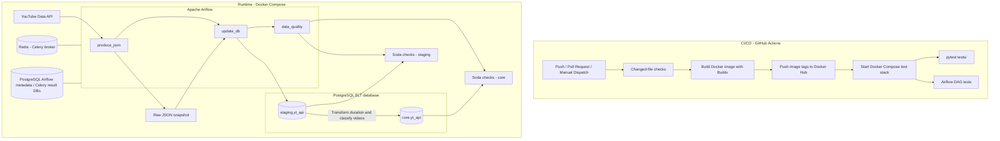

# YouTube Analytics ELT Pipeline

A containerized data engineering project that extracts video metadata and statistics from the YouTube Data API, stores dated JSON snapshots, loads the records into PostgreSQL, transforms them into a core schema, and validates data quality with Soda Core. Apache Airflow orchestrates the workflow, while Docker Compose provides the local runtime environment.

This repository demonstrates practical skills in API ingestion, workflow orchestration, ELT design, relational data modeling, data quality validation, automated testing, containerization, and CI/CD. It is intended for learning and portfolio demonstration; the current implementation has known limitations and is **not production-ready**.

## Table of contents

- [Project overview](#project-overview)
- [Motivation](#motivation)
- [Dataset](#dataset)
- [Architecture](#architecture)
- [Technology stack](#technology-stack)
- [Data pipeline](#data-pipeline)
- [Repository structure](#repository-structure)
- [Prerequisites](#prerequisites)
- [Configuration](#configuration)
- [Build and start the stack](#build-and-start-the-stack)
- [Run the pipeline](#run-the-pipeline)
- [PostgreSQL data model](#postgresql-data-model)
- [Data quality](#data-quality)
- [Testing](#testing)
- [GitHub Actions CI/CD](#github-actions-cicd)
- [Useful SQL queries](#useful-sql-queries)
- [Troubleshooting](#troubleshooting)
- [Security notes](#security-notes)
- [Known limitations and future improvements](#known-limitations-and-future-improvements)
- [License and attribution](#license-and-attribution)

## Project overview

The pipeline retrieves publicly available video information for a YouTube channel using the YouTube Data API. Each extraction creates a date-stamped JSON snapshot. Airflow then coordinates loading and transformation in PostgreSQL, followed by Soda data quality checks.

## Motivation

This project is a practical introduction to data engineering workflows: extracting data with Python, orchestrating tasks with Airflow, packaging services with Docker, modeling data in PostgreSQL, and applying automated data quality checks. It also includes pytest coverage and a GitHub Actions workflow to demonstrate parts of a CI/CD process.

## Dataset

The source is the YouTube Data API. The target channel is selected through the `CHANNEL_HANDLE` configuration; the code does not hard-code a particular channel. The extractor requests video ID, title, upload timestamp, duration, view count, like count, and comment count. Availability of the engagement statistics depends on the API response.

### Key capabilities

- Extracts video IDs and video details through the YouTube Data API.
- Handles uploads-playlist pagination and batches video-detail requests.
- Stores raw extraction output as date-stamped JSON files.
- Loads source records into a PostgreSQL `staging` schema.
- Transforms duration values and classifies videos in the PostgreSQL `core` schema.
- Runs Soda checks on the staging and core layers.
- Provides pytest tests and Airflow DAG test commands through a GitHub Actions workflow.
- Uses Docker Compose to run Airflow, PostgreSQL, and Redis locally.

## Architecture

The runtime ELT pipeline and the CI/CD workflow are separate flows. Airflow orchestrates runtime data tasks; GitHub Actions validates changes and builds/pushes the custom image when its configured conditions are met.


*The image is a high-level overview. Its Soda inventory and CI ordering differ from the current implementation; the Mermaid diagram and detailed sections below describe the repository's actual checks and workflow.*



### Runtime sequence

1. `produce_json` calls the YouTube Data API and writes a dated JSON snapshot.
2. `update_db` loads the snapshot into `staging.yt_api`, then transforms records into `core.yt_api`.
3. `data_quality` runs Soda checks against the staging and core tables.

The Compose stack uses PostgreSQL for the Airflow metadata database, Celery result backend database, and ELT database. Redis is used as the Celery broker.

## Technology stack

| Area | Technology | Purpose |
|---|---|---|
| Source | YouTube Data API | Video metadata and statistics |
| Extraction | Python, `requests` | API requests and JSON generation |
| Raw storage | JSON | Dated source snapshots |
| Orchestration | Apache Airflow 2.9.2, CeleryExecutor | Scheduling and task coordination |
| Containers | Docker, Docker Compose | Repeatable local runtime |
| Database | PostgreSQL 13 | Staging and core data layers |
| Data quality | Soda Core PostgreSQL checks | Completeness, uniqueness, and plausibility checks |
| Automated testing | pytest | Unit, integration, and DAG integrity tests |
| CI/CD | GitHub Actions, Docker Buildx, Docker Hub | Workflow automation and image publication |

The custom Airflow image is based on `apache/airflow:2.9.2-python3.10` and installs the dependencies listed in `requirements.txt`.

## Data pipeline

### Airflow DAGs

The DAG definitions are located in [`dags/main.py`](dags/main.py). The DAGs are configured with `catchup=False`; Compose may create DAGs in a paused state, so they may need to be unpaused in the Airflow UI.

| DAG | Trigger / schedule | Responsibility |
|---|---|---|
| `produce_json` | Daily at 14:00 in `Europe/Malta`, or manual trigger | Retrieves the channel uploads playlist, fetches video details, writes JSON, and triggers `update_db`. |
| `update_db` | Triggered by `produce_json` | Loads JSON into staging, synchronizes core, then triggers `data_quality`. |
| `data_quality` | Triggered by `update_db` | Runs Soda checks against staging and core. |

### Extracted fields

The extraction code retrieves the following fields where returned by the API:

- Video ID
- Video title
- Upload date
- Duration
- View count
- Likes count
- Comments count

The uploads playlist is paginated. Video-detail requests are batched in groups of up to 50 IDs. The JSON file uses the naming pattern `data/youtube_video_data_YYYY-MM-DD.json`, based on the container's current date.

### Transformation logic

The staging layer stores the raw ISO 8601 duration text. The core layer stores duration as PostgreSQL `TIME` and classifies a video as `Shorts` when its duration is 60 seconds or less; longer videos are classified as `Normal`.

The warehouse helpers contain insert, update, and delete paths based on video IDs. See [Known limitations and future improvements](#known-limitations-and-future-improvements) for current synchronization limitations.

## Repository structure

```text
.
├── dags/
│   ├── api/
│   │   └── video_stats.py              # YouTube API extraction and JSON output
│   ├── dataquality/
│   │   └── soda.py                     # Soda scan task helper
│   ├── datawarehouse/                  # Loading, transformation, and SQL helpers
│   └── main.py                         # Three Airflow DAGs
├── data/                               # Shared JSON input/output files
├── docker/postgres/                    # PostgreSQL initialization script
├── include/soda/                       # Soda connection configuration and checks
├── tests/                              # pytest unit, integration, and DAG checks
├── .github/workflows/
│   └── ci-cd-elt.yaml                  # GitHub Actions workflow
├── docker-compose.yaml                 # Airflow, Redis, and PostgreSQL stack
├── dockerfile                          # Custom Airflow image definition (lowercase name)
├── requirements.txt                    # Additional Python dependencies
└── README.md
```

## Prerequisites

- Git
- Docker Desktop with Docker Compose v2, or Docker Engine with the Compose plugin
- A YouTube Data API key with the YouTube Data API enabled
- A YouTube channel handle
- A Docker Hub account if you intend to publish the custom image

The commands below use PowerShell and should be run from the repository root.

## Configuration

The repository expects a root `.env` file for local configuration. Do not commit this file. Values below are placeholders; use unique credentials for your local environment.

```dotenv
AIRFLOW_WWW_USER_USERNAME=airflow
AIRFLOW_WWW_USER_PASSWORD=<choose-a-local-password>
AIRFLOW_UID=50000

API_KEY=<youtube-data-api-key>
CHANNEL_HANDLE=<youtube-channel-handle>
FERNET_KEY=<generated-fernet-key>

POSTGRES_CONN_HOST=postgres
POSTGRES_CONN_PORT=5432
POSTGRES_CONN_USERNAME=postgres
POSTGRES_CONN_PASSWORD=<choose-a-postgres-password>

METADATA_DATABASE_NAME=airflow_metadata
METADATA_DATABASE_USERNAME=airflow_metadata_user
METADATA_DATABASE_PASSWORD=<choose-a-password>

CELERY_BACKEND_NAME=airflow_celery
CELERY_BACKEND_USERNAME=airflow_celery_user
CELERY_BACKEND_PASSWORD=<choose-a-password>

ELT_DATABASE_NAME=youtube_analytics
ELT_DATABASE_USERNAME=youtube_analytics_user
ELT_DATABASE_PASSWORD=<choose-a-password>
```

The variable names and default values must remain consistent with `docker-compose.yaml` and the PostgreSQL initialization script. The current Postgres hook passes `youtube_analytics` as the database name, so `ELT_DATABASE_NAME` should be set to `youtube_analytics` for the current implementation.

Generate a Fernet key using the same Airflow base image, then paste the output into `.env`:

```powershell
docker run --rm apache/airflow:2.9.2-python3.10 python -c "from cryptography.fernet import Fernet; print(Fernet.generate_key().decode())"
```

Keep the Fernet key stable for an initialized Airflow environment. Changing it can make previously encrypted connection or variable values unreadable.

### GitHub Actions secrets and variables

Open the repository's **Settings → Secrets and variables → Actions** and add the values referenced by [`ci-cd-elt.yaml`](.github/workflows/ci-cd-elt.yaml).

The workflow currently references these secrets:

- `AIRFLOW_WWW_USER_PASSWORD`
- `AIRFLOW_WWW_USER_USERNAME`
- `API_KEY`
- `CELERY_BACKEND_NAME`
- `CELERY_BACKEND_PASSWORD`
- `CELERY_BACKEND_USERNAME`
- `DOCKERHUB_PASSWORD`
- `ELT_DATABASE_NAME`
- `ELT_DATABASE_PASSWORD`
- `ELT_DATABASE_USERNAME`
- `FERNET_KEY`
- `METADATA_DATABASE_NAME`
- `METADATA_DATABASE_PASSWORD`
- `METADATA_DATABASE_USERNAME`
- `POSTGRES_CONN_HOST`
- `POSTGRES_CONN_PASSWORD`
- `POSTGRES_CONN_PORT`
- `POSTGRES_CONN_USERNAME`

It currently references these repository variables:

- `AIRFLOW_UID`
- `CHANNEL_HANDLE`
- `DOCKERHUB_NAMESPACE`
- `DOCKERHUB_REPOSITORY`
- `DOCKERHUB_USERNAME`

Some non-sensitive values are currently referenced as secrets because that is how the workflow is written. If you store those values as repository variables instead, update the workflow references from `secrets.NAME` to `vars.NAME` as appropriate. Never put secret values directly in YAML or commit `.env`.

## Build and start the stack

The repository's Dockerfile is named `dockerfile` in lowercase. Docker's default filename is `Dockerfile`, and Linux runners are case-sensitive. Until the file naming and CI configuration are aligned, build it explicitly and use the image tag expected by Compose:

```powershell
docker build -f dockerfile -t ousworkstation/youtube-analytics-airflow:1.0.0 .
docker compose up --no-build -d
```

Check the services and follow scheduler/worker logs:

```powershell
docker compose ps
docker compose logs -f airflow-scheduler airflow-worker
```

When the Airflow webserver is healthy, open [http://localhost:8080](http://localhost:8080) and sign in with `AIRFLOW_WWW_USER_USERNAME` and `AIRFLOW_WWW_USER_PASSWORD` from `.env`.

The DAGs may be paused after first creation. Unpause `produce_json` from the Airflow UI or trigger it manually. The downstream DAGs are triggered by the upstream tasks when the workflow completes successfully.

## Run the pipeline

You can trigger the extraction DAG from PowerShell:

```powershell
docker compose exec airflow-scheduler airflow dags trigger produce_json
```

The intended sequence is:

`produce_json` → `update_db` → `data_quality`

Monitor task states in the Airflow UI. If a task fails, open its task log before rerunning the DAG so you can address the underlying error.

## PostgreSQL data model

The ELT database contains a `yt_api` table in each schema. The DAG creates the schemas and tables if they do not exist.

| Column | `staging.yt_api` | `core.yt_api` |
|---|---|---|
| `Video_ID` | `VARCHAR(11)`, primary key, required | `VARCHAR(11)`, primary key, required |
| `Video_Title` | `TEXT`, required | `TEXT`, required |
| `Upload_Date` | `TIMESTAMP`, required | `TIMESTAMP`, required |
| `Duration` | `VARCHAR(20)`, required | `TIME`, required |
| `Video_Type` | Not present | `VARCHAR(10)`, required |
| `Video_Views` | `INT` | `INT` |
| `Likes_Count` | `INT` | `INT` |
| `Comments_Count` | `INT` | `INT` |

The view, like, and comment counts may be null because the extraction code reads those statistics with optional lookups and the table definitions do not mark them `NOT NULL`.

## Data quality

[`include/soda/checks.yml`](include/soda/checks.yml) defines checks against the `yt_api` table in each schema:

- `Video_ID` contains no missing values.
- `Video_ID` contains no duplicates.
- `Likes_Count` must not exceed `Video_Views`.
- `Comments_Count` must not exceed `Video_Views`.

The PostgreSQL connection settings are stored in [`include/soda/configuration.yml`](include/soda/configuration.yml). The `data_quality` DAG runs Soda with `SCHEMA=staging` and then `SCHEMA=core`.

These checks validate the listed rules only. They do not currently provide broad schema-drift detection, a freshness SLA, or comprehensive duration/statistics range validation. Checks on an empty table can pass without validating actual records, so confirm row counts before interpreting a Soda scan as meaningful validation.

## Testing

The pytest suite runs inside the Airflow worker, where Airflow and the project dependencies are available:

```powershell
docker compose exec airflow-worker pytest tests/ -v
```

According to the test files, the suite covers Airflow Variable fixtures, a mocked PostgreSQL connection, DAG import integrity, expected DAG IDs, task counts, and integration checks. The integration tests can require valid credentials, network access, the live YouTube API, and running PostgreSQL services.

Run the Soda checks directly inside the worker if you need to investigate them separately from the DAG:

```powershell
docker compose exec airflow-worker soda scan -d pg_datasource -c /opt/airflow/include/soda/configuration.yml -v SCHEMA=staging /opt/airflow/include/soda/checks.yml
docker compose exec airflow-worker soda scan -d pg_datasource -c /opt/airflow/include/soda/configuration.yml -v SCHEMA=core /opt/airflow/include/soda/checks.yml
```

The target schema and `yt_api` table must exist. For useful data validation, they should also contain representative data.

## GitHub Actions CI/CD

The workflow is [`ci-cd-elt.yaml`](.github/workflows/ci-cd-elt.yaml). It is configured for pushes to `main` and `feature/*`, pull requests targeting `main`, and manual `workflow_dispatch` runs.

The current workflow has two dependent jobs:

1. `build-and-push-image` checks for changes to `Dockerfile` and `requirements.txt`, then uses Docker Buildx to push the `latest` and commit-SHA tags when its condition is satisfied.
2. `unit-and-integration-and-e2e-tests` starts Compose, runs `pytest tests/`, attempts to test all three DAGs with `airflow dags test`, and tears down Compose when the cleanup step runs.

### CI configuration issues to be aware of

The workflow has known issues that should be addressed before treating it as a reliable CI/CD pipeline:

- The repository file is named `dockerfile`, but the build path filter looks for `Dockerfile` and the build command does not specify `--file dockerfile`. This can cause changes to be missed and image builds to fail on case-sensitive runners.
- The Compose image tag is hard-coded as `ousworkstation/youtube-analytics-airflow:1.0.0`, while CI publishes configurable `latest` and commit-SHA tags. The tags need to be aligned for the test stack to use the intended image.
- The test job's path filter does not include `tests/**` or `.github/workflows/**`, so some relevant changes may skip the tests unless the workflow is manually dispatched.
- GitHub Actions jobs use separate runners; an image built in the build job is not automatically available in the test job. The second job must pull a published tag or build its own image.
- The cleanup step does not use an unconditional execution condition, so it might not run after a preceding step fails.
- The exact `airflow dags test` command and its execution date should be verified against the Airflow CLI version in the image.

These are configuration observations, not claims that the current workflow has passed. Fix and validate them before relying on automatic image publication or CI test results.

## Useful SQL queries

Open a `psql` session in the PostgreSQL container. The following command uses the container's configured superuser and the ELT database name:

```powershell
docker compose exec postgres sh -lc 'psql -U "$POSTGRES_USER" -d "$ELT_DATABASE_NAME"'
```

List the pipeline tables:

```sql
SELECT schemaname, tablename
FROM pg_tables
WHERE schemaname IN ('staging', 'core')
ORDER BY schemaname, tablename;
```

Compare loaded row counts:

```sql
SELECT 'staging' AS schema_name, COUNT(*) AS row_count FROM staging.yt_api
UNION ALL
SELECT 'core', COUNT(*) FROM core.yt_api;
```

Inspect recent core records:

```sql
SELECT "Video_ID", "Video_Title", "Duration", "Video_Type", "Video_Views"
FROM core.yt_api
ORDER BY "Upload_Date" DESC
LIMIT 10;
```

Exit `psql` with `\q`. The PostgreSQL service publishes host port `5432` for external database clients, if configured in Compose.

## Troubleshooting

| Symptom | What to check |
|---|---|
| Docker cannot find `Dockerfile` | The repository file is lowercase `dockerfile`. Build with `docker build -f dockerfile ...` or rename the file and update Compose/workflow references consistently. |
| `Broken DAG` in Airflow | Run `docker compose exec airflow-scheduler airflow dags list-import-errors` and inspect the reported import error. |
| Today's JSON snapshot is missing | Trigger `produce_json`, then confirm the dated JSON file exists under the shared `data/` directory and that the loader expects the same date/name. |
| `staging.yt_api` does not exist | Confirm the `staging_table` task successfully creates the schema and table before querying existing IDs. |
| Tables exist but contain zero rows | Inspect `staging_table` and `core_table` task logs, insertion/update logic, transaction commits, and row counts before running Soda checks. |
| PostgreSQL connection errors | Verify Compose service health, database names, usernames, passwords, and the initialization history of the PostgreSQL volume. Init scripts generally run only when the database data directory is first initialized. |
| Soda cannot find its YAML files | Confirm the files and commands use the same extension (`.yml` or `.yaml`) and the expected container paths. |
| Soda reports passes on empty tables | Check row counts first; zero-row tables can make some quality rules pass without testing source data. |

## Security notes

- Keep `.env` local and ensure it is ignored by Git. Review `git status` before every commit.
- Do not commit API keys, passwords, Fernet keys, connection URIs, or any other credential.
- Restrict the YouTube API key to the required API and rotate it if exposed.
- Use different passwords for PostgreSQL service users.
- Keep this development stack on a trusted machine/network. The Compose configuration exposes local web/database ports for development.
- Keep the Fernet key stable for an existing Airflow environment unless you plan and execute a proper key-rotation procedure.

## Known limitations and future improvements

The following items are limitations or potential follow-up work, not implemented features:

- Fix `update_rows()` so staging records are updated when an existing video changes.
- Move reconciliation/deletion logic outside insert-only branches so removals are processed consistently.
- Replace the hard-coded ELT database name in the Postgres hook with connection-driven configuration.
- Add API request timeouts, retry/backoff, and clearer error handling for quota and network failures.
- Expand Soda checks for data freshness, duration ranges, non-negative statistics, and other business rules.
- Align the Dockerfile name, Compose tag, CI filters, image publishing, and test job environment.
- Ensure CI runs when tests or workflow files change and always cleans up services after failures.
- Add a sanitized `.env.example` with placeholders and no credentials.
- Add a repeatable test-data strategy so CI does not depend on live YouTube API calls for routine unit tests.
